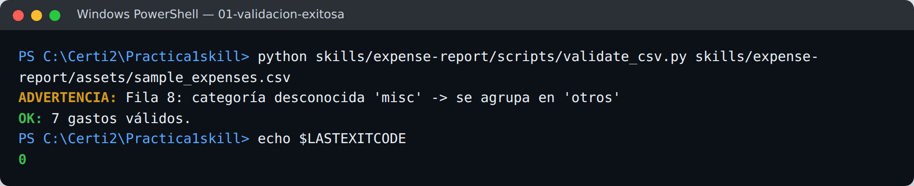
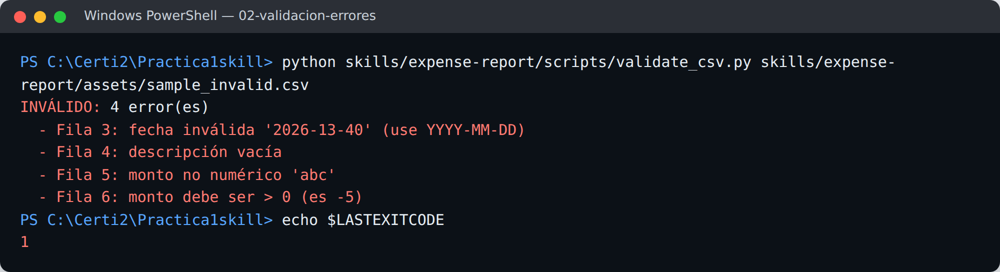
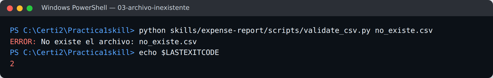
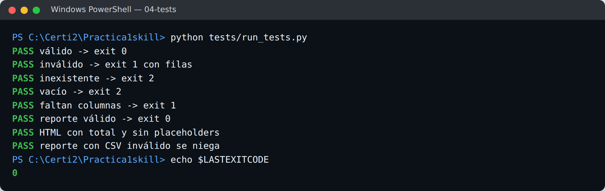
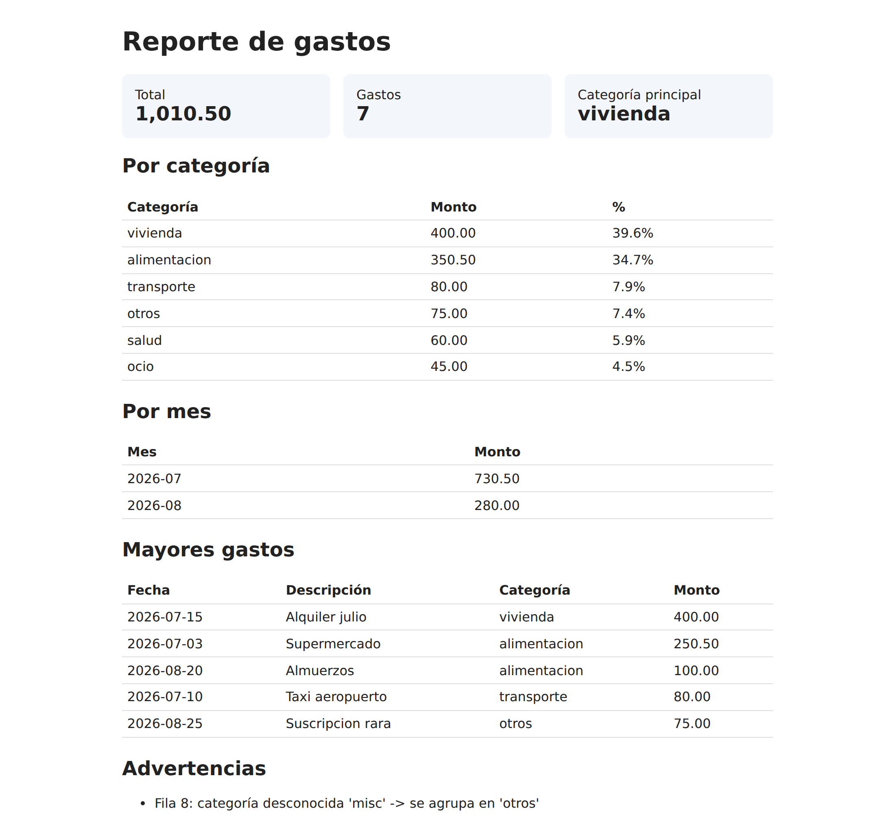

# expense-report — skill para Claude Code

Skill que valida un CSV de gastos y genera un reporte HTML (totales, por categoría, por mes, mayores gastos).

## Estructura
```
skills/expense-report/
├── SKILL.md                    # cuándo usarla y flujo paso a paso
├── scripts/                    # validate_csv.py, generate_report.py, common.py
├── assets/                     # plantilla HTML y CSV de ejemplo (válido e inválido)
└── references/                 # formato del CSV y categorías (JSON leído por el validador)
tests/run_tests.py              # pruebas exitosas y de error
```

## Requisitos
Python 3.9+ (sin dependencias externas).

## Instalación
Copia la carpeta al directorio de skills de Claude Code:

```bash
# global
cp -r skills/expense-report ~/.claude/skills/
# o por proyecto
cp -r skills/expense-report <tu-proyecto>/.claude/skills/
```
Luego pide en Claude Code: *"genera el reporte de gastos de mis_gastos.csv"*.

## Uso manual
```bash
python skills/expense-report/scripts/validate_csv.py skills/expense-report/assets/sample_expenses.csv
python skills/expense-report/scripts/generate_report.py skills/expense-report/assets/sample_expenses.csv -o reporte.html
```

## Ejemplo
Entrada (`sample_expenses.csv`):
```
fecha,descripcion,categoria,monto
2026-07-03,Supermercado,alimentacion,250.50
2026-07-15,Alquiler julio,alquiler,400.00
...
```
Salida esperada:
```
OK: 7 gastos válidos.
ADVERTENCIA: Fila 8: categoría desconocida 'misc' -> se agrupa en 'otros'
Reporte generado: reporte.html | total 1,010.50 | categoría principal: vivienda
```

## Manejo de errores
| Situación | Resultado | Exit |
|---|---|---|
| CSV válido | `OK: N gastos válidos.` | 0 |
| Fecha/monto/descripción inválidos | Lista de errores con número de fila; no se genera el reporte | 1 |
| Faltan columnas | `Faltan columnas obligatorias: ...` | 1 |
| Archivo inexistente, vacío o no UTF-8 | `ERROR: ...` | 2 |

Ejemplo con `assets/sample_invalid.csv`:
```
INVÁLIDO: 4 error(es)
  - Fila 3: fecha inválida '2026-13-40' (use YYYY-MM-DD)
  - Fila 4: descripción vacía
  - Fila 5: monto no numérico 'abc'
  - Fila 6: monto debe ser > 0 (es -5)
```

## Pruebas
```bash
python tests/run_tests.py
```
Ejecuta 8 verificaciones (caso exitoso + errores).

## Capturas
**1. Validación exitosa** (`sample_expenses.csv`, exit 0)



**2. Validación con errores** (`sample_invalid.csv`, exit 1: 4 filas con error)



**3. Archivo inexistente** (exit 2)



**4. Pruebas** (`tests/run_tests.py`: 8 PASS)



**5. Reporte generado** (`reporte.html` abierto en el navegador)



## Decisiones de diseño
- **Solo biblioteca estándar**: instalación cero.
- **Validar antes de generar**: el reporte nunca se calcula con datos dudosos; los códigos de salida permiten a Claude decidir el siguiente paso.
- **Categorías en `references/categories.json`**: se editan sin tocar código.
- **Plantilla en `assets/`**: cambiar el diseño no requiere tocar Python.
